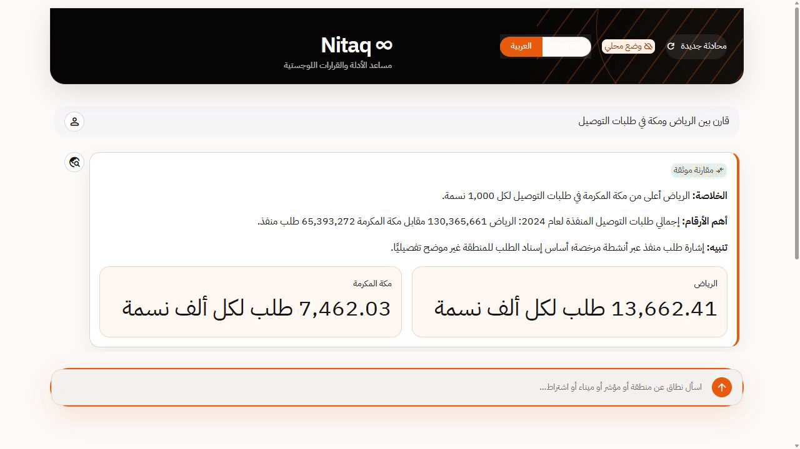
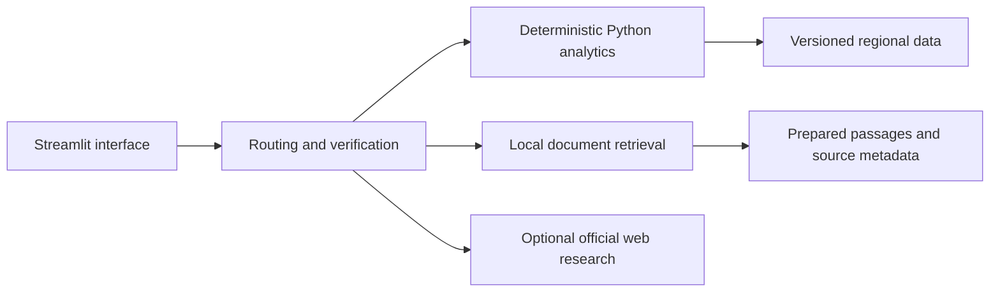

# Nitaq | Saudi logistics evidence copilot

[](https://github.com/NaderAljohani/nitaq/actions/workflows/ci.yml)

Nitaq answers Arabic and English questions about Saudi regional logistics using
documented data and cited passages. It covers 13 regions and 17 source metrics.
Python tools calculate comparisons and screening results; the conversational
layer routes questions and explains the evidence.



Ten-second walkthrough of the running application in local evidence mode:
an Arabic question, the comparison chart, its data table, and the source references.

The repository runs in local evidence mode without an API key. An optional
Groq integration adds model-assisted conversation.

## What it does

- Compares regional delivery activity, warehousing measures, population, and related logistics indicators.
- Retrieves definitions and requirements using lexical and subword retrieval, with source metadata and page references.
- Produces charts and structured comparisons in a bilingual Streamlit interface.
- Checks evidence and numerical grounding before returning an answer.
- Restricts optional web research to configured official-source domains.

## Quick start

Use Python 3.13. Run these commands from the repository root:

```bash
python -m venv .venv
# Windows PowerShell: .venv\Scripts\Activate.ps1
# macOS/Linux: source .venv/bin/activate
python -m pip install -r requirements-lock.txt
python -m streamlit run streamlit_app.py
```

No setup key is required for the default local evidence mode. For optional
model-assisted conversation, copy `.env.example` to `.env`, add your own
`GROQ_API_KEY`, and set `NITAQ_UI_OFFLINE=0`. Model availability depends on your
provider account. Technical conversation logging is disabled by default.

For Streamlit hosting, use `streamlit_app.py` as the entrypoint. Store a real
key in the platform's Secrets panel, rather than a tracked file. The supported
dependency ranges are in `requirements.txt`; `requirements-lock.txt` records
the resolved dependencies used for local verification.

New configurations use `NITAQ_PRIMARY_MODEL`, `NITAQ_FAST_MODEL`,
`NITAQ_MAX_TOOL_ITERATIONS`, `NITAQ_RAG_TOP_K`, `NITAQ_UI_OFFLINE`, and
`NITAQ_UI_DEVELOPER_MODE`. Their older `MIZAN_*` equivalents remain supported;
when both names are set, the `NITAQ_*` value takes precedence.

## Try it

Ask `Compare Riyadh and Makkah` or `قارن بين الرياض ومكة` for a regional
comparison with a table and chart. Ask `ماهي البيانات المتوفرة؟` to inspect
the available datasets. Source metadata accompanies analytical results.

## Architecture



| Path | Contents |
|---|---|
| `nitaq/agent/` | Routing, provider integration, guardrails, response verification |
| `nitaq/tools/` | Read-only data access and deterministic analytics |
| `nitaq/rag/` | Retrieval, source ingestion, and official web research |
| `nitaq/ui/` | Dashboard rendering and theme |
| `data/processed/` | Runtime datasets and prepared retrieval index |
| `knowledge/` | Source catalog, metric cards, and extraction metadata |
| `tests/` | Offline analytics, retrieval, agent, and UI checks |

## Data and limitations

The application analyses a versioned historical snapshot. Licensed warehouse counts and area do not
measure occupancy or usable capacity. Delivery counts do not measure unmet
demand. Regional rankings are screening outputs; missing rent, competition,
cost, occupancy, and profitability evidence limits investment conclusions.

The prepared index is included for reproducible local retrieval. Original PDFs
and the local source-data ZIP are omitted. Rebuilding the index requires the
original documents listed in the source catalog. Excerpts retain their source
attribution. See [data and sources](docs/DATA.md),
[limitations](docs/LIMITATIONS_AR.md), and [license status](LICENSE_NOTICE.md).

## Verification

```bash
python scripts/check_release.py
python -m pytest -q
```

The test suite includes a 100-question offline evaluation, grounding checks,
retrieval provenance, configuration compatibility, and headless UI interactions.
The linked CI runs the release checks and tests on Windows and Linux. Live
provider response quality requires separate evaluation.

## Design choices

Python tools calculate numerical results before the conversational layer
explains them. This keeps comparisons tied to the same dataset and calculation
path. Retrieval combines lexical matching with deterministic subword hashing;
it does not require a downloaded embedding model. The local evidence mode
supports demos and regression checks without provider credentials.

[الدليل العربي](README_AR.md) | [Preparation changes](docs/PREPARATION.md)
