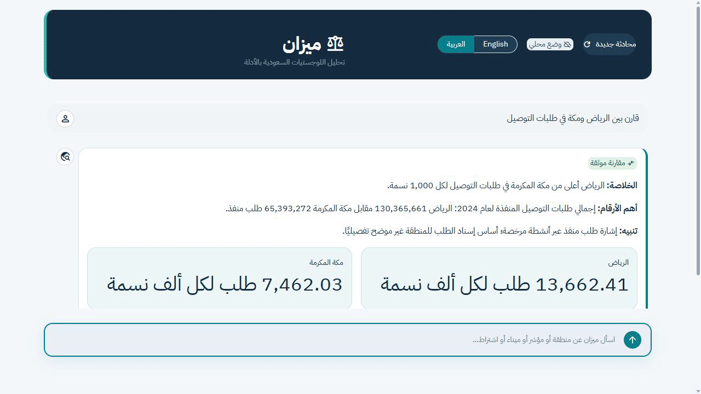

# ميزان: مساعد أدلة اللوجستيات السعودية

يجيب المشروع عن الأسئلة بالعربية والإنجليزية باستخدام بيانات إقليمية موثقة
ومقاطع مسترجعة مع مراجعها. يغطي 13 منطقة و17 مؤشراً مصدرياً، ويحسب المقارنات
بأدوات Python قبل عرض الإجابة والرسوم في واجهة Streamlit.



عرض مدته 10 ثوانٍ من التطبيق أثناء تشغيله محلياً: السؤال العربي، ثم الرسم
والجدول ومراجع المصادر من تبويبات المقارنة.

[الصفحة الرئيسية](docs/images/mizan-home.jpg) · [بنية النظام](docs/architecture/mizan-current-architecture.svg)

## التشغيل

استخدم Python 3.13 من جذر المستودع:

```powershell
python -m venv .venv
.venv\Scripts\Activate.ps1
python -m pip install -r requirements-lock.txt
python -m streamlit run streamlit_app.py
```

يعمل الوضع المحلي دون مفتاح. لتفعيل المحادثة بمساعدة النموذج، انسخ
`.env.example` إلى `.env`، وأضف مفتاحك في `GROQ_API_KEY` واضبط
`MIZAN_UI_OFFLINE=0`. لا ترفع ملف `.env`.

تستخدم الإعدادات بادئة `MIZAN_`. عند تحديث نسخة محلية موجودة، انطلق من
ملف `.env.example` المرفق وراجع أسماء الإعدادات في [الدليل الإنجليزي](README.md).

## تجربة سريعة

اسأل «قارن بين الرياض ومكة» لعرض المقارنة والجدول والرسم، أو «ماهي البيانات
المتوفرة؟» لاستعراض البيانات المتاحة. تحسب أدوات Python النتائج الرقمية،
ويستخدم الاسترجاع مطابقة الكلمات وتجزئة الكلمات الفرعية دون تنزيل نموذج تضمين.

## حدود المشروع

البيانات لقطة تاريخية وليست تحديثاً حياً. تراخيص المستودعات ومساحاتها لا تثبت
الإشغال أو السعة التشغيلية. المقارنات أداة استكشاف وفرز أولي، ولا تكفي وحدها
لدراسة جدوى أو قرار استثماري.

تتضمن نسخة النشر بيانات التشغيل والفهرس المجهز، ولا تتضمن ملفات PDF الأصلية
أو أرشيف المصادر المحلي. إعادة بناء الفهرس تتطلب استعادة المصادر المبينة في
[دليل البيانات](docs/DATA.md). لم يُختر ترخيص مفتوح المصدر للكود بعد.

## التحقق

```powershell
python scripts/check_release.py
python -m pytest -q
```

تشمل الاختبارات الاسترجاع وتوثيق المصادر والإجابات الرقمية وتفاعل الواجهة.
تُشغّل [الاختبارات الآلية](https://github.com/NaderAljohani/mizan/actions/workflows/ci.yml)
على Windows وLinux. جودة إجابات مزود النموذج تحتاج تقييماً منفصلاً.

راجع [الدليل الإنجليزي](README.md) و[تغييرات التجهيز](docs/PREPARATION.md).
